# Orbit – dein Alltag, verbunden

Orbit ist eine native SwiftUI-App fürs iPhone, entstanden aus dem Design-Entwurf „App-Hub“. Sie bündelt Kalender, Gmail, Spotify und Discord und erledigt mit **Flows** wiederkehrende Routinen: Sie schickt dir Nachrichten, erinnert dich vor Terminen, pausiert die Musik und sagt deinem Team auf Discord Bescheid.

## Was Orbit kann

| Bereich | Funktionen |
|---|---|
| **Orbit (Start)** | Datum & Begrüßung, „Heute“-Kennzahlen (Termine, ungelesene Mails, aktive Flows), nächster Termin, laufende Musik mit Steuerung, Posteingang, Discord-Karte mit Schnellnachrichten, deine Flows zum Antippen |
| **Flows** | Routinen aus Auslöser + Schritten. Vorlagen: Morgen-Briefing, Meeting-Modus, Mail-Wächter, Feierabend, Fokuszeit, Abendvorschau. Eigener Editor mit Platzhaltern wie `{termin}`, `{termine_heute}`, `{absender}` |
| **Aktivität** | Verlauf aller Nachrichten, Discord-Posts, Spotify-Aktionen und Erinnerungen, nach Tagen gruppiert, mit Badge für Neues |
| **Einstellungen** | Design, Konnektoren, Mitteilungen, Kurzbefehle |

### Flows

| Auslöser | Schritte |
|---|---|
| Manuell (Tipp, Siri, Kurzbefehle-App) | Nachricht aufs iPhone |
| Zur Uhrzeit (mit Wochentagen) | Discord-Nachricht über Webhook |
| X Minuten vor jedem Termin | Spotify pausieren / Playlist starten |
| Neue Mail (optional nur von bestimmten Absendern) | Erinnerung nach X Minuten |

Wie zuverlässig was läuft – iOS erlaubt Apps keine Dauer-Hintergrundprozesse:

- **Nachrichten** zu Uhrzeit- und Termin-Flows plant Orbit im Voraus als iOS-Mitteilungen (7 Tage). Sie kommen pünktlich, auch wenn Orbit geschlossen ist.
- **Discord-, Spotify- und Erinnerungsschritte** dieser Flows laufen, wenn du in der Mitteilung auf **„Aktionen ausführen“** tippst (lange drücken) – Orbit muss dafür nicht geöffnet werden.
- **Vollautomatisch** geht es mit der Kurzbefehle-App: *Automation › Tageszeit* (o. Ä.) › Aktion **„Flow ausführen“** von Orbit wählen. Dann laufen alle Schritte ohne Tippen.
- **Neue Mails** prüft Orbit beim Öffnen und bei der Hintergrundaktualisierung, die iOS gelegentlich gewährt.

### Konnektoren

| Konnektor | Was funktioniert | Wie |
|---|---|---|
| **Google Kalender** | Termine der nächsten 7 Tage, Kalender ein-/ausblenden, neue Termine, Teilnehmende anschreiben | EventKit (Kalender des iPhones, inkl. Google-Konto) – keine Einrichtung nötig |
| **Gmail** | Ungelesene Mails, Posteingang, Mail-Wächter-Flow | Gmail-API mit OAuth + PKCE, nur Lesezugriff |
| **Spotify** | Aktueller Titel, Play/Pause/Vor/Zurück, Playlists, Flow-Schritte | Spotify-Web-API mit OAuth + PKCE |
| **Discord** | Nachrichten in deinen Kanal senden (Composer, Schnellnachrichten, Flows), optional letzte Kanal-Nachrichten lesen | Webhook (ohne Passwort); optional Bot-Token zum Mitlesen |

### Design

Modernes, dunkles Glas-Design (Liquid Glass ab iOS 26) über einem Bild deiner Wahl:

- **fünf mitgelieferte Bilder** (Nordlicht, Dünen, Gebirge, Tiefsee, Glut), **eigenes Foto** oder Verläufe
- Unschärfe, Abdunklung und fünf Akzentfarben
- echte **Logos** von Google Kalender, Gmail, Spotify und Discord auf den Konnektor-Kacheln
- neues App-Icon und Willkommensbildschirm

## Vorschau

Aufgenommen im iOS-Simulator mit Beispieldaten (werden bei jedem Build automatisch aktualisiert):

| Willkommen | Orbit | Flows | Flow bearbeiten |
|---|---|---|---|
| 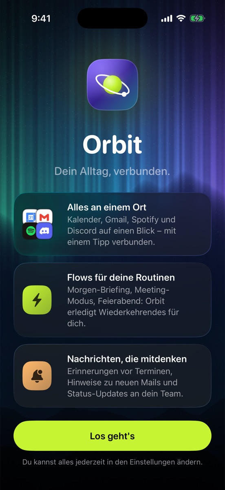 | 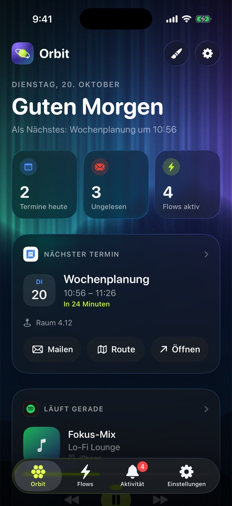 | 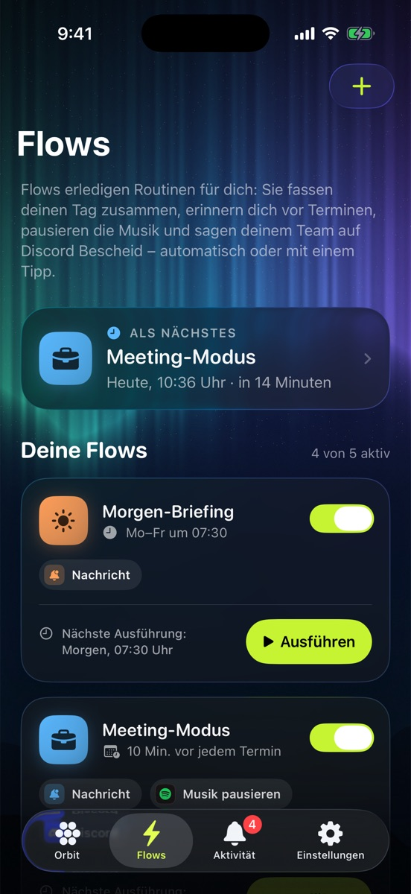 | 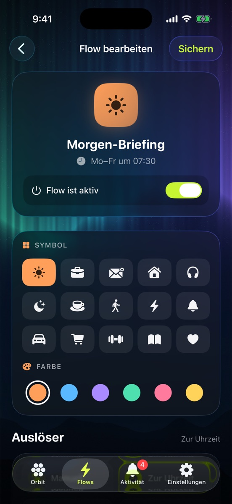 |

| Aktivität | Discord | Einstellungen | Design |
|---|---|---|---|
| 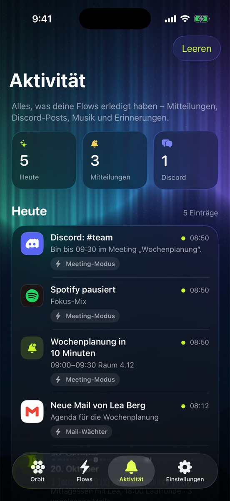 | 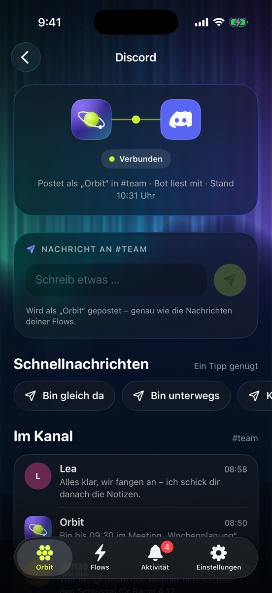 | 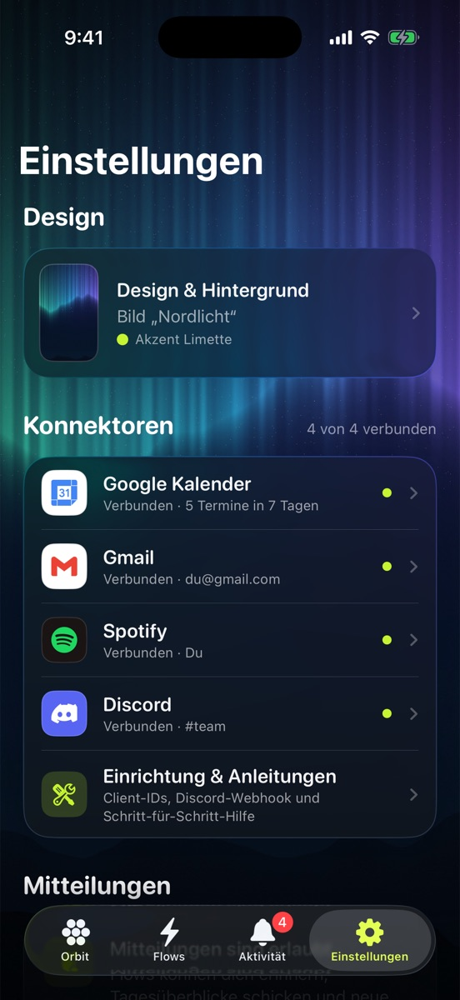 | 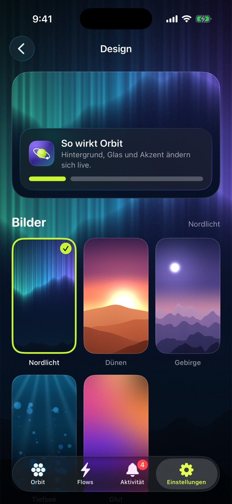 |

| Kalender | Spotify | Gmail | Discord verbinden |
|---|---|---|---|
| 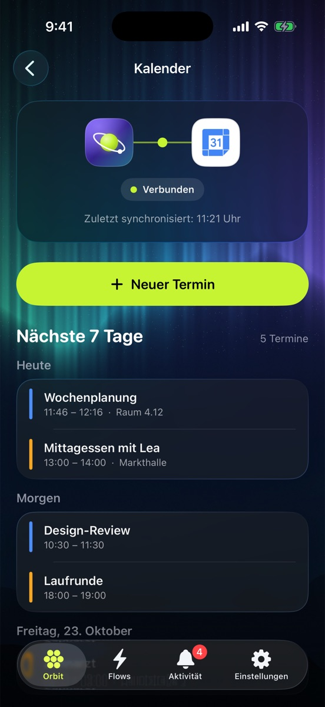 | 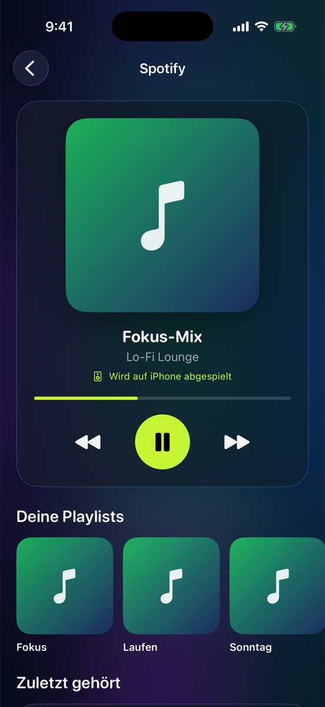 | 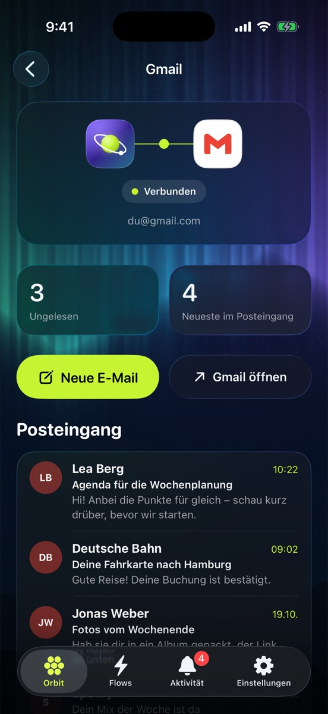 | 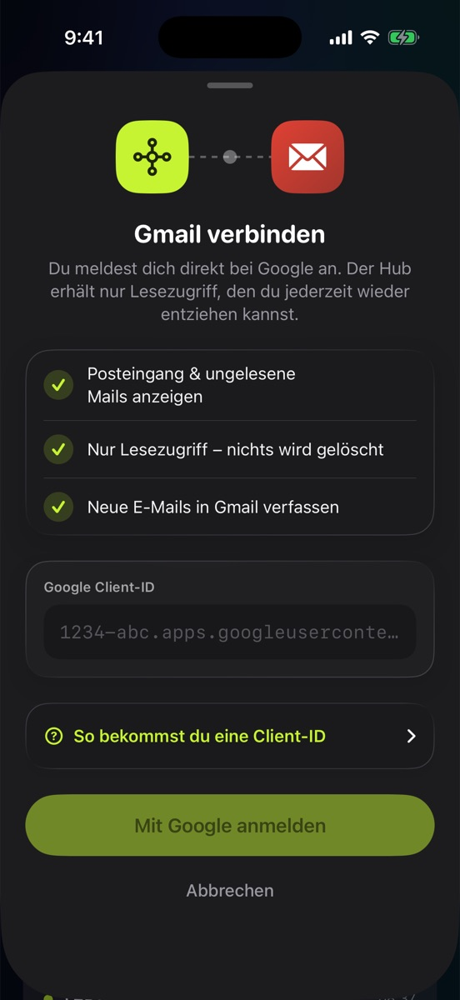 |

## Installieren

### Mit einem Mac

1. Xcode 16 oder neuer installieren.
2. `AppHub-iOS/AppHub.xcodeproj` öffnen.
3. Target **AppHub** › *Signing & Capabilities* › bei *Team* deine Apple-ID wählen. Meldet Xcode, dass die Bundle-ID vergeben ist, ändere `com.yarazu.AppHub` in etwas Eigenes.
4. iPhone anschließen, als Ziel wählen, ▶︎ drücken.
5. Auf dem iPhone: *Einstellungen › Datenschutz & Sicherheit › Entwicklermodus* einschalten und unter *Allgemein › VPN & Geräteverwaltung* deiner Apple-ID vertrauen.

### Ohne Mac

Bei jedem Push baut GitHub Actions die App. Unter *Actions* › letzter Lauf von „Orbit (iOS-App) bauen“ › *Artifacts* liegt `AppHub-unsigned-ipa`. Die enthaltene `.ipa` kannst du mit [Sideloadly](https://sideloadly.io) oder [AltStore](https://altstore.io) mit deiner Apple-ID installieren.

Mit einer kostenlosen Apple-ID läuft die App 7 Tage, danach einfach neu installieren.

## Konnektoren einrichten

Die Anleitungen stehen auch in der App (*Einstellungen › Einrichtung & Anleitungen*), mit Kopier-Buttons. Zugangsdaten liegen im iOS-Schlüsselbund, es gibt keinen fremden Server dazwischen.

**Gmail** – In der [Google Cloud Console](https://console.cloud.google.com/projectcreate) ein Projekt anlegen, die [Gmail API](https://console.cloud.google.com/apis/library/gmail.googleapis.com) aktivieren, den OAuth-Zustimmungsbildschirm (Zielgruppe „Extern“, dich als Testnutzer) einrichten und eine OAuth-Client-ID vom Typ **iOS** mit der Bundle-ID der App anlegen. Client-ID in Orbit einfügen.

**Spotify** – Im [Developer Dashboard](https://developer.spotify.com/dashboard) eine App mit Redirect-URI `apphub://spotify-callback` und „Web API“ anlegen, Client-ID in Orbit einfügen. Steuerung braucht Premium.

**Discord** – Im Server: *Server-Einstellungen › Integrationen › Webhooks › Neuer Webhook*, Kanal wählen, *Webhook-URL kopieren* und in Orbit einfügen. Optional zum Mitlesen: im [Developer Portal](https://discord.com/developers/applications) einen Bot anlegen, „Message Content Intent“ aktivieren, den Bot zum Server einladen und sein Token in Orbit eintragen.

**Kalender** – Google-Konto unter *Einstellungen › Apps › Kalender › Kalender-Accounts* hinzufügen und in Orbit den Zugriff erlauben.

## Aufbau

```
AppHub/
├── AppHubApp.swift            App, Tabs, Navigation, Willkommen, Toast
├── Model/
│   ├── FlowModels.swift       Flows, Auslöser, Schritte, Platzhalter, Vorlagen
│   ├── ActivityLog.swift      Verlauf „Aktivität“
│   ├── Appearance.swift       Bilder, eigenes Foto, Verläufe, Akzent
│   ├── Connector.swift        Kalender, Gmail, Spotify, Discord (+ Logos)
│   └── HubStore.swift         Zentraler Zustand
├── Services/
│   ├── FlowEngine.swift       Ausführen, Mitteilungen planen, Hintergrund, Mitteilungs-Aktionen
│   ├── FlowIntents.swift      Kurzbefehle / Siri („Flow ausführen“)
│   ├── DiscordService.swift   Webhook + optionaler Bot
│   ├── OAuth.swift            OAuth 2.0 + PKCE, Schlüsselbund
│   ├── CalendarService.swift  EventKit
│   ├── GmailService.swift     Gmail-API
│   └── SpotifyService.swift   Spotify-Web-API
├── Views/                     Orbit, Flows, Editor, Aktivität, Einstellungen, Detailseiten, Design
└── Assets.xcassets            App-Icon, Logos, Hintergrundbilder
```

Voraussetzungen: iOS 17 oder neuer, Xcode 16 oder neuer. Der Projektordner heißt aus technischen Gründen weiter `AppHub-iOS`, auf dem iPhone erscheint die App als „Orbit“.

Die Logos von Google Kalender, Gmail, Spotify und Discord sind Marken ihrer jeweiligen Inhaber und stammen aus [Simple Icons](https://simpleicons.org) (CC0). Sie werden nur verwendet, um die verbundenen Dienste zu kennzeichnen.
