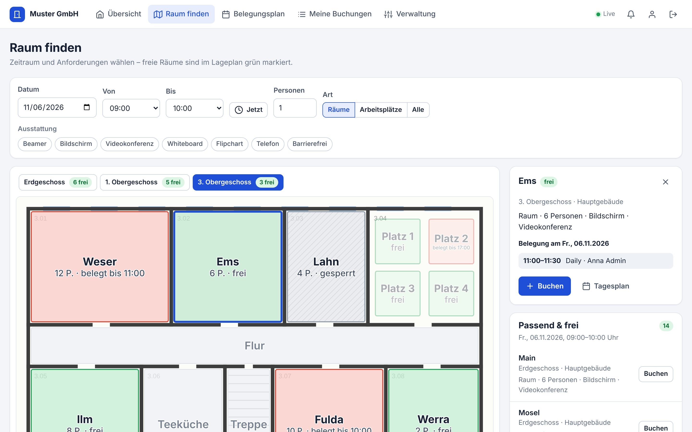
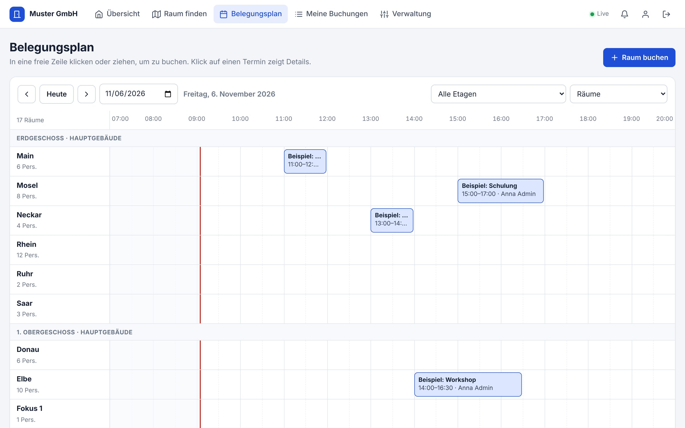
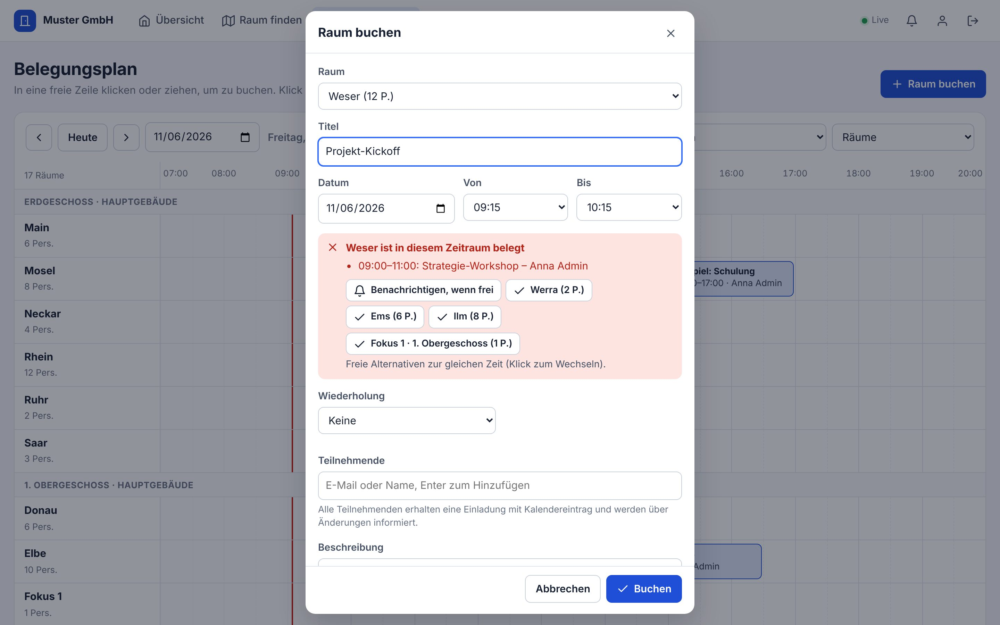
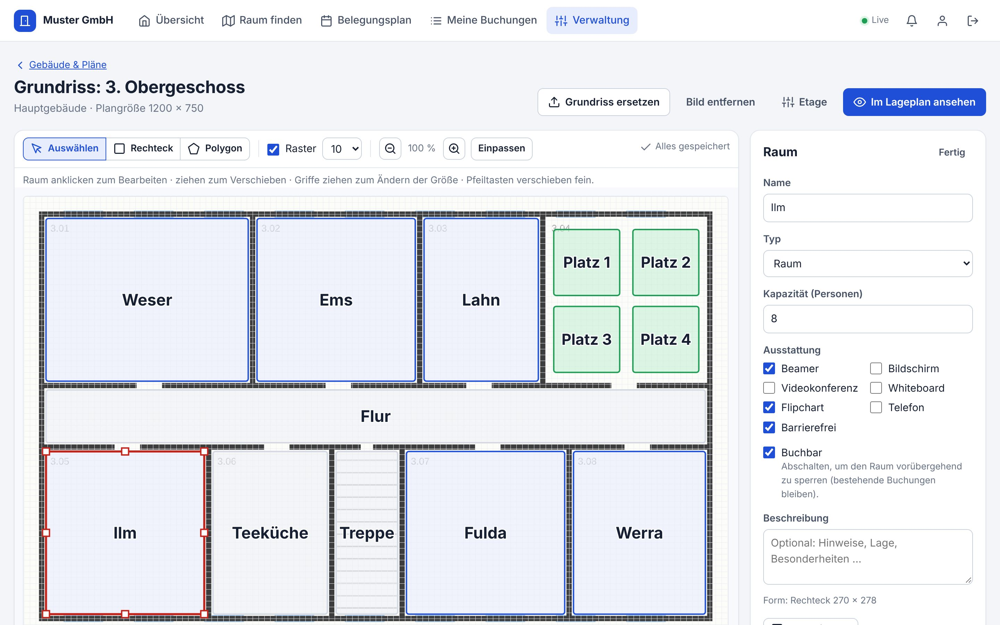

# Raumplaner

Zuverlässige Raumbuchung fürs Unternehmen – mit hinterlegtem **Lageplan der Gebäude** und **Benachrichtigungen über alle Kanäle**. Selbst gehostet, ohne Cloud-Dienste, ohne externe Skripte oder Schriften.



## Funktionen

**Infrastruktur hinterlegen**
- Gebäude → Etagen → Räume, Arbeitsplätze (Desk-Sharing) und nicht buchbare Bereiche (Flur, Küche, Treppenhaus …)
- Grundriss als Bild hochladen (PNG, JPG, WebP, GIF, SVG) und Räume darauf als **Rechteck oder Polygon** einzeichnen
- Kapazität, Ausstattung (Beamer, Videokonferenz, Whiteboard, barrierefrei …) und Beschreibung pro Raum
- Editor mit Raster, Zoom, Duplizieren (ideal für Arbeitsplatzreihen), Tastaturkürzeln und automatischem Speichern
- Beispielgebäude auf Knopfdruck zum Ausprobieren

**Planen & buchen**
- **Raum finden:** Zeitraum, Personenzahl und Ausstattung wählen – passende freie Räume leuchten im Lageplan grün
- **Belegungsplan:** Tagesansicht aller Räume, buchen per Klick oder durch Ziehen in der Zeitleiste
- Live-Verfügbarkeitsprüfung im Buchungsdialog mit **freien Alternativen** zur selben Zeit
- Serientermine (werktäglich, wöchentlich, 14-täglich, monatlich), Teilnehmende, private Termine
- Laufende Termine **vorzeitig beenden** – der Raum ist sofort wieder frei
- Sperrungen durch die Administration (z. B. Wartung) – betroffene Buchungen werden storniert und alle informiert





**Immer benachrichtigt**

| Ereignis | Wer | In der App (live) | E-Mail | Kalender |
|---|---|:---:|:---:|---|
| Buchung bestätigt | Buchende | – ¹ | ✓ | Termin wird eingetragen (.ics) |
| Einladung | Teilnehmende | ✓ | ✓ | Einladung (.ics) |
| Änderung (Zeit, Raum, Titel) | alle Beteiligten | ✓ | ✓ | Termin wird aktualisiert |
| Absage / Storno / Sperrung | alle Beteiligten | ✓ | ✓ | Termin wird entfernt |
| Erinnerung vor Beginn (einstellbar) | Buchende und eingeladene Konten | ✓ | ✓ | – |
| **Raum ist frei geworden** („Benachrichtigen, wenn frei“) | wer sich vorgemerkt hat | ✓ | ✓ | – |

¹ Wer selbst bucht, sieht die Bestätigung sofort im Bildschirm.

Dazu: **Desktop-Benachrichtigungen** im Browser, ein **persönliches Kalender-Abo** (Outlook, Google, Apple) und eine Test-Benachrichtigung im Profil, um alle Kanäle zu prüfen. E-Mails lassen sich pro Person abbestellen – in der App wird trotzdem immer benachrichtigt.

**Verwaltung**
- Benutzer & Rollen, Selbstregistrierung (auf Firmen-Domains beschränkbar), Passwort zurücksetzen, Konten deaktivieren
- Buchungsregeln (max. Dauer, Vorlauf, Zeitraster, Ausstattungsliste)
- Systemseite mit E-Mail-Status, Warteschlange („erneut senden“), Datensicherung und Protokoll (wer hat wann was gebucht/storniert)

## Warum zuverlässig?

| Risiko | Wie der Raumplaner damit umgeht |
|---|---|
| Doppelbuchungen | Prüfung in der Anwendung **und** ein Datenbank-Trigger als zweite Sicherung. Getestet: 20 gleichzeitige Buchungsversuche auf denselben Slot → genau einer gewinnt. |
| Mailserver kurz nicht erreichbar | E-Mails werden in derselben Transaktion wie die Buchung gespeichert (Outbox) und automatisch wiederholt (nach 1, 2, 5, 15, 30, 60 Min., 3 h, 6 h). Keine Buchung ohne Benachrichtigung, keine Benachrichtigung ohne Buchung. |
| Server-Neustart | Offene E-Mails und fällige Erinnerungen werden nachgeholt; jede Erinnerung kommt genau einmal. |
| Verbindung im Browser bricht ab | Anzeige „Offline“, automatische Wiederverbindung und Nachladen – angezeigte Belegungen sind nie veraltet. |
| Datenverlust | Automatische, konsistente Sicherung (standardmäßig täglich, 14 Stück) plus „Jetzt sichern“. Alles – auch Grundrisse – steckt in einer Datei. |
| Sommer-/Winterzeit | Feste Firmen-Zeitzone; Serientermine bleiben auf derselben Uhrzeit. |
| Mitarbeitende verlassen das Unternehmen | Beim Deaktivieren werden ihre zukünftigen Buchungen freigegeben und Teilnehmende informiert. |
| Datenschutz | Selbst gehostet, keine externen Ressourcen, Passwörter mit scrypt, private Termine, Schutz gegen CSRF, XSS und Passwort-Raten. |

## Schnellstart

### Mit Docker (empfohlen)

```bash
cd raumplaner
cp .env.example .env    # PUBLIC_URL und ggf. SMTP eintragen
docker compose up -d --build
```

### Ohne Docker

Voraussetzung: [Node.js](https://nodejs.org) **22.13 oder neuer** (es wird keine separate Datenbank benötigt).

```bash
cd raumplaner
npm ci
cp .env.example .env
npm start
```

Danach **http://localhost:3000** öffnen (bzw. die Adresse aus `PUBLIC_URL`).

## Erste Schritte

1. **Ersteinrichtung:** Name der Organisation und das erste Konto anlegen – es erhält Administratorrechte.
2. **Verwaltung → Gebäude & Pläne:** Gebäude und Etagen anlegen – oder zuerst das **Beispielgebäude laden**, um alles auszuprobieren.
3. **Grundriss & Räume:** Grundriss hochladen (PDF-Pläne vorher als PNG exportieren), mit *Rechteck* oder *Polygon* die Räume einzeichnen, Name, Kapazität und Ausstattung festlegen.
4. **Verwaltung → Einstellungen:** Firmen-Domain für die Selbstregistrierung eintragen (z. B. `firma.de`) und Buchungsregeln anpassen.
5. **E-Mail einrichten** (siehe unten) und unter *System & E-Mail* eine Test-E-Mail senden.
6. Den Link an die Kolleginnen und Kollegen schicken – sie registrieren sich mit ihrer Firmen-Adresse oder du legst die Konten selbst an.



## E-Mail einrichten

Ohne Mailserver funktionieren In-App-, Live- und Desktop-Benachrichtigungen trotzdem. Für E-Mails die SMTP-Daten in `.env` eintragen und neu starten:

| Umgebung | Einstellungen |
|---|---|
| Microsoft 365 / Exchange Online | `SMTP_HOST=smtp.office365.com`, `SMTP_PORT=587`, Benutzer + Passwort eines Postfachs, für das „SMTP AUTH“ erlaubt ist |
| Exchange im eigenen Netz (Relay) | `SMTP_HOST=mail.firma.local`, `SMTP_PORT=25`, ohne Benutzer – die IP des Servers muss am Relay freigegeben sein |
| Google Workspace | `SMTP_HOST=smtp.gmail.com`, `SMTP_PORT=587`, Benutzer + App-Passwort |

`SMTP_FROM` sollte eine Adresse sein, die der Mailserver für das Konto erlaubt (z. B. `Raumplaner <raumplaner@firma.de>`). Zum Ausprobieren ohne echten Versand: `MAIL_LOG_ONLY=true` – die E-Mails erscheinen dann im Server-Protokoll.

## Konfiguration

Alle Optionen stehen kommentiert in [`.env.example`](.env.example).

| Variable | Standard | Bedeutung |
|---|---|---|
| `PUBLIC_URL` | `http://localhost:3000` | Adresse für Links in E-Mails und das Kalender-Abo |
| `PORT` | `3000` | Port des Servers |
| `APP_TIMEZONE` | `Europe/Berlin` | Zeitzone für Anzeige und Planung |
| `DATA_DIR` | `./data` | Ablage für Datenbank und Sicherungen |
| `SMTP_HOST`, `SMTP_PORT`, `SMTP_SECURE`, `SMTP_USER`, `SMTP_PASS`, `SMTP_FROM` | – | E-Mail-Versand |
| `SMTP_TLS_REJECT_UNAUTHORIZED` | `true` | nur bei internem Mailserver mit selbst signiertem Zertifikat auf `false` |
| `MAIL_LOG_ONLY` | `false` | E-Mails nur protokollieren |
| `TRUST_PROXY` | `false` | hinter einem Reverse Proxy auf `true` setzen |
| `COOKIE_SECURE` | automatisch | sichere Cookies (bei `https://` in `PUBLIC_URL` automatisch an) |
| `BACKUP_INTERVAL_HOURS` / `BACKUP_KEEP` | `24` / `14` | automatische Datensicherung (`0` = aus) |
| `SESSION_DAYS` | `30` | Dauer der Anmeldung |

## Betrieb

**Datensicherung und Wiederherstellung.** Die Datenbank liegt in `data/raumplaner.db`, die automatischen Sicherungen in `data/backups/`. Wiederherstellen: Raumplaner stoppen, die gewünschte Sicherung als `data/raumplaner.db` kopieren (vorhandene `raumplaner.db-wal`/`-shm` löschen), wieder starten. Für die externe Sicherung genügt es, den Ordner `data/backups/` mitzusichern.

**HTTPS / Reverse Proxy.** Für den Betrieb im Firmennetz am besten hinter nginx, Traefik oder IIS mit Zertifikat. Wichtig sind die Einstellungen für die Live-Verbindung:

```nginx
location / {
    proxy_pass http://127.0.0.1:3000;
    proxy_set_header Host $host;
    proxy_set_header X-Forwarded-For $proxy_add_x_forwarded_for;
    proxy_set_header X-Forwarded-Proto $scheme;
    proxy_buffering off;          # Live-Benachrichtigungen sofort durchreichen
    proxy_read_timeout 1h;
    client_max_body_size 16m;     # Grundriss-Uploads
}
```

Dazu in `.env`: `PUBLIC_URL=https://raumplaner.firma.de` und `TRUST_PROXY=true`.

**Als Dienst ohne Docker (Linux/systemd)** – Datei `/etc/systemd/system/raumplaner.service`:

```ini
[Unit]
Description=Raumplaner
After=network.target

[Service]
WorkingDirectory=/opt/raumplaner
ExecStart=/usr/bin/node --disable-warning=ExperimentalWarning server/index.js
Restart=always
User=raumplaner

[Install]
WantedBy=multi-user.target
```

**Update:** neuen Stand holen, `npm ci` (bzw. `docker compose up -d --build`) und neu starten. Datenbank-Änderungen werden beim Start automatisch übernommen.

**Überwachung:** `GET /api/health` liefert `{"status":"ok"}` – geeignet für Monitoring und den Docker-Healthcheck.

## Entwicklung & Tests

```bash
npm run dev    # Server mit automatischem Neustart
npm test       # automatisierte Tests
```

Die Tests prüfen u. a.: keine Doppelbuchungen (auch bei parallelen Anfragen und direkt in der Datenbank), Serientermine über die Zeitumstellung, Sperrungen, Berechtigungen, private Termine, E-Mail-Inhalte und Kalenderdateien, Erinnerungen (genau einmal, Nachholen nach Ausfall), „Benachrichtigen, wenn frei“, Wiederholversuche beim Mailversand, Live-Kanal, Kalender-Abo und Anmeldeschutz.

**Aufbau**

```
server/            Node.js-Backend (Express, eingebautes SQLite)
  bookings.js      Buchungslogik: Konflikte, Serien, Sperrungen, Storno
  notifier.js      Benachrichtigungen (In-App, E-Mail, Kalendereinladungen)
  mailer.js        E-Mail-Outbox mit Wiederholversuchen
  reminders.js     Erinnerungen vor Terminbeginn
  watches.js       „Benachrichtigen, wenn frei“
  layout.js        Gebäude, Etagen, Räume, Grundrisse
  schema.js        Datenbankschema inkl. Schutz-Trigger
public/            Oberfläche (ohne Build-Schritt, keine externen Ressourcen)
  js/views/        Übersicht, Raum finden, Belegungsplan, Verwaltung, Editor …
  shared/time.js   Zeitzonen- und Serienlogik (Server und Browser)
test/              automatisierte Tests (node --test)
```

## Grenzen und mögliche Erweiterungen

- **Anmeldung:** eigene Konten mit E-Mail und Passwort. Single Sign-on (Microsoft Entra ID, LDAP/Active Directory) ist noch nicht eingebaut.
- **Outlook-Raumpostfächer** werden nicht synchronisiert; Termine gelangen per Kalendereinladung und Kalender-Abo in Outlook.
- **Benachrichtigungen bei geschlossenem Browser** kommen per E-Mail; Web-Push ist nicht eingebaut.
- **Check-in / automatische Freigabe** nicht wahrgenommener Buchungen ist eine naheliegende nächste Ausbaustufe.
- Ausgelegt für einen Server mit eingebauter SQLite-Datenbank – für Hunderte Räume und Nutzer ausreichend.
